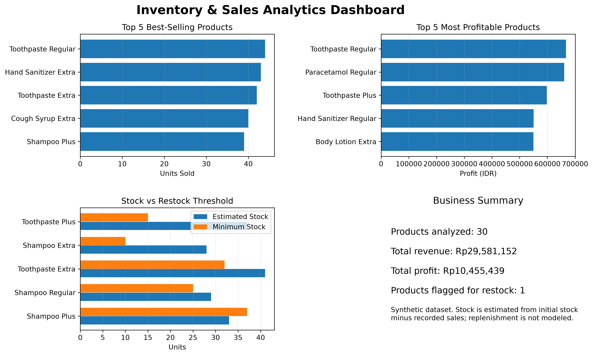

# Inventory & Sales Analytics Dashboard

A Python portfolio project that simulates product inventory and sales transactions, analyzes business performance, and generates a visual dashboard.

**Note:** This project uses synthetic data generated for educational and portfolio purposes. The results do not represent a real business.

## Project Objectives

- Generate a simulated product catalog and sales transactions.
- Perform basic data quality checks.
- Calculate revenue, product costs, and profit.
- Identify best-selling and most profitable products.
- Estimate remaining stock and flag products that may need restocking.
- Visualize key business metrics in a dashboard.

## Tools & Technologies

- **Python 3.13** — data generation and analysis.
- **CSV** — data storage and exchange.
- **Matplotlib** — charts and dashboard visualization.
- **Visual Studio Code** — development environment.

## Project Files

| File | Description |
|---|---|
| `generate_inventory.py` | Generates synthetic product and sales data. |
| `products.csv` | Product master data, including prices and initial stock. |
| `sales.csv` | Simulated sales transactions. |
| `quality_check.py` | Performs basic product-data validation checks. |
| `final_check.py` | Verifies dataset counts, unique IDs, product references, and consistency of sales metrics. |
| `sales_analysis.py` | Calculates revenue and profit and summarizes product performance. |
| `transaction_analysis.csv` | Transaction-level data enriched with product details and calculated metrics. |
| `product_summary.csv` | Product-level summary, including sales, revenue, profit, and estimated stock status. |
| `final_dashboard.py` | Builds the consolidated business dashboard. |
| `inventory_sales_dashboard.png` | Exported dashboard image. |

## Key Business Metrics

- **Revenue** = Quantity Sold × Selling Price
- **Product Cost** = Quantity Sold × Cost Price
- **Profit** = Revenue − Product Cost
- **Estimated Remaining Stock** = Initial Stock − Recorded Quantity Sold

The dashboard includes best-selling products, most profitable products, stock comparisons against minimum thresholds, and a business summary.

## How to Run the Project

Run these commands in the VS Code terminal from the project folder.

1. Generate the datasets:

   `python generate_inventory.py`

2. Run the basic data checks:

   `python quality_check.py`

3. Calculate sales metrics and generate summary files:

   `python sales_analysis.py`

4. Generate the dashboard:

   `python final_dashboard.py`

Matplotlib must be installed before running the dashboard. Install it with:

`python -m pip install matplotlib`

## Limitations

- All products and transactions are simulated.
- Data values and rankings can change when the random data generator is run again.
- Estimated stock subtracts recorded sales from initial stock; the project does not model replenishment, purchase orders, or real-time inventory movements.
- The results are intended to demonstrate a data-analysis workflow, not to support real inventory decisions.

## Project Status

The synthetic datasets, analysis scripts, validation checks, summary files, and dashboard have been created. A final audit verifies dataset relationships and confirms that transaction-level and product-level totals reconcile. The project uses synthetic data, and estimated stock does not account for replenishment.

## Dashboard Preview

